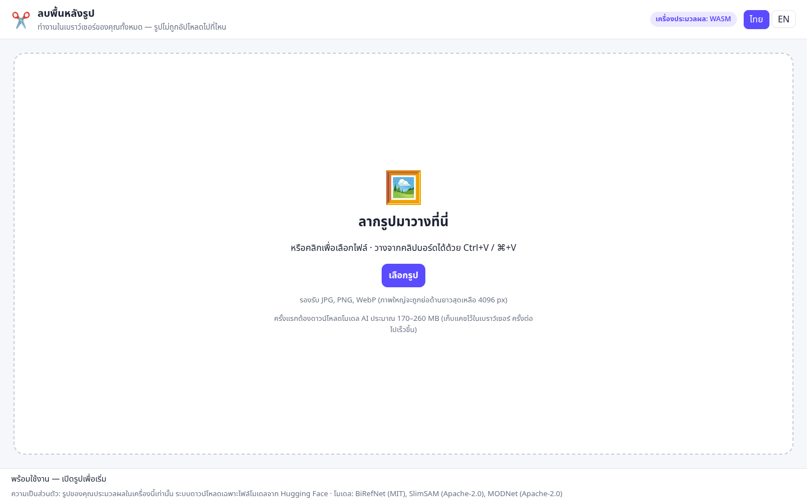
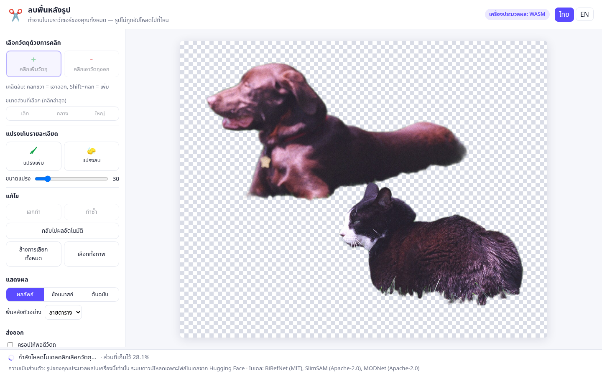

# ลบพื้นหลังรูป (Background Remover) — v0.1

**ใช้งานได้ที่** [https://benzz9769.github.io/bg-remover/](https://benzz9769.github.io/bg-remover/)

เว็บแอปลบพื้นหลังรูปภาพที่ **ประมวลผลในเบราว์เซอร์ทั้งหมด** รูปที่เปิดในแอปไม่ถูกอัปโหลดและไม่ถูกส่งออกจากเบราว์เซอร์ — โมเดลรันบนเครื่องของผู้ใช้ (WebGPU หรือ WASM) มีเพียงไฟล์น้ำหนักโมเดลที่ดาวน์โหลดจาก Hugging Face
ใช้ได้ทั้ง Windows และ Mac ผ่านเบราว์เซอร์ (แนะนำ Chrome / Edge รุ่นใหม่)

> รายละเอียดการออกแบบ เหตุผลที่เลือกโมเดล สัญญาอนุญาต และความเสี่ยง ดูที่ [SPEC.md](./SPEC.md)

## English

[Background Remover](https://benzz9769.github.io/bg-remover/) is a static site that cuts subjects out of photos entirely on your device. Images never leave the browser: nothing is uploaded, and the picture is not sent to a server. Model weights are downloaded from Hugging Face the first time you use a model and then cached locally.

- Automatic cutout with BiRefNet-lite-512 (MIT) or MODNet (Apache-2.0)
- Click to add or remove an object with SlimSAM (Apache-2.0)
- Brush, undo/redo, and transparent PNG download
- Thai (default) and English UI

The app source is [MIT](./LICENSE) (Copyright 2026 benzz9769). Model credits are in the table below. The rest of this README is in Thai.

## ภาพหน้าจอ

หน้าเริ่มต้น (ภาษาไทย) และผลลบพื้นหลังอัตโนมัติจากรูปทดสอบ `test-assets/socks-buddy-lawn.jpg`





## ทำอะไรได้บ้าง

1. เปิดรูป: ลากมาวาง / คลิกเลือกไฟล์ / วางจากคลิปบอร์ด (Ctrl+V หรือ ⌘+V)
2. ลบพื้นหลังอัตโนมัติด้วยโมเดล BiRefNet lite (512×512)
3. คลิกที่วัตถุเพื่อ **เพิ่ม** หรือ **เอาออก** จากส่วนที่เก็บไว้ (ใช้ SlimSAM)
   - คลิกซ้าย = ตามเครื่องมือที่เลือก, **คลิกขวา = เอาออก**, **Shift+คลิก = เพิ่ม**
   - ถ้าได้วัตถุเล็กหรือใหญ่เกินไป เลือก "เล็ก / กลาง / ใหญ่" ของคลิกล่าสุดได้
4. แปรงเก็บรายละเอียด: แปรงเพิ่ม / แปรงลบ ปรับขนาดได้
5. เลิกทำ / ทำซ้ำ (Ctrl+Z, Ctrl+Shift+Z หรือ Ctrl+Y), กลับไปผลอัตโนมัติ, ล้างทั้งหมด, เลือกทั้งภาพ
6. ดูผลบนพื้นลายตาราง / ขาว / ดำ / เขียว หรือโหมดซ้อนมาสก์
7. ดาวน์โหลด PNG โปร่งใส (เลือกครอปให้พอดีวัตถุได้) ชื่อไฟล์ `<ชื่อเดิม>-nobg.png`
8. หน้าจอภาษาไทย (ค่าเริ่มต้น) และภาษาอังกฤษ

## เริ่มใช้งาน (สำหรับนักพัฒนา)

ต้องมี Node.js 20+

```bash
npm ci
npm test           # unit tests (vitest) ของส่วนที่ไม่ใช่ ML
npm run build      # คัดลอก wasm + service worker แล้วสร้างไฟล์ static ไว้ที่ dist/
npm run dev        # เปิดที่ http://localhost:5173/bg-remover/ (ส่ง header COOP/COEP ให้แล้ว)
npm run preview    # เสิร์ฟ dist/ ที่ http://localhost:4173/bg-remover/
npm run e2e        # ทดสอบ end-to-end ด้วย headless Chrome (ต้อง build ก่อน)
```

- `npm run build` รัน `npm run assets` ก่อน (`scripts/copy-assets.mjs`) เพื่อคัดลอก ONNX Runtime WASM และ `coi-serviceworker.js` เข้า `public/` — ไฟล์เหล่านี้ไม่ถูก commit
- `npm run e2e` ใช้ Chrome ที่ `/usr/bin/google-chrome` ถ้ามี (หรือกำหนด `CHROME=/path/to/chrome`)
  ถ้าไม่มี Chrome ให้ติดตั้ง Chromium ของ Playwright: `npx playwright install chromium`
- `scripts/e2e-all.sh` รัน 3 กรณี: WASM, WebGPU (SwiftShader), และกรณีบังคับให้ WebGPU พังเพื่อทดสอบการถอยไปใช้ WASM
- ผลการทดสอบอยู่ที่ `artifacts/` (ไม่ถูก commit)

### พารามิเตอร์ใน URL (สำหรับทดสอบ)

| พารามิเตอร์ | ค่า | ความหมาย |
|---|---|---|
| `device` | `auto` (ค่าเริ่มต้น), `wasm`, `webgpu` | บังคับเครื่องประมวลผลของโมเดลลบพื้นหลัง |
| `samDevice` | `wasm` (ค่าเริ่มต้น), `webgpu` | เครื่องประมวลผลของ SlimSAM |
| `model` | `birefnet-lite` (ค่าเริ่มต้น), `modnet` | โมเดลลบพื้นหลังอัตโนมัติ |

## โครงสร้างโค้ด

```
index.html              หน้าจอหลัก (มี data-i18n สำหรับแปลภาษา)
src/main.ts             UI: โหลดรูป, เครื่องมือ, วาดผล, ส่งออก, undo/redo
src/i18n.ts             ข้อความภาษาไทย/อังกฤษ
src/style.css           ดีไซน์
src/lib/mask.ts         ตรรกะมาสก์ (รวม/ลบ, แปรง, dilate, ล้างเศษขอบ, levels) — ไม่มี DOM, มี unit test
src/lib/export.ts       ใส่ alpha, ครอป, ตั้งชื่อไฟล์ — มี unit test
src/lib/history.ts      undo/redo — มี unit test
src/ml/worker.ts        Web Worker ที่รัน transformers.js (BiRefNet / MODNet / SlimSAM)
src/ml/protocol.ts      ชนิดข้อความระหว่าง UI กับ worker + รายชื่อโมเดล (pin revision)
scripts/copy-assets.mjs คัดลอกไฟล์ ONNX Runtime WASM และ coi-serviceworker ไปไว้ใน public/
scripts/e2e.mjs         ทดสอบ end-to-end ด้วย Playwright
tests/                  unit tests
test-assets/            รูปทดสอบ (ที่มาดู test-assets/SOURCES.md)
docs/screenshots/       ภาพหน้าจอใน README
.github/workflows/      deploy ไป GitHub Pages เมื่อพุชขึ้น main
```

## การทำงานของมาสก์ (สรุป)

มาสก์สุดท้าย = มาสก์อัตโนมัติ (ปรับ levels ให้ค่า 0/255 ชัด) แล้วนำ "การแก้ไข" แต่ละครั้งมาใช้ตามลำดับ

- คลิกเพิ่มวัตถุ → `max(มาสก์, มาสก์ SAM)`
- คลิกเอาวัตถุออก → ขยายมาสก์ SAM ออก ~1 ช่องความละเอียดของ SAM (ด้านยาว/256 px, อย่างน้อย 2 px) แล้วลบออก จากนั้นลบ "เศษขอบ" เล็กๆ ที่เหลืออยู่ติดกับวัตถุที่ลบ
- แปรงเพิ่ม/ลบ → วาดวงกลมต่อกันตามเส้น (ขอบนุ่ม 1 px)
- ล้างทั้งหมด / เลือกทั้งภาพ → เติม 0 / 255

ประวัติเก็บได้ 40 ขั้น เกินกว่านั้นขั้นที่เก่าที่สุดจะถูก "อบ" รวมเข้ามาสก์ฐาน (ผลลัพธ์ไม่เปลี่ยน แต่เลิกทำย้อนไปไม่ได้)

## การนำไปโฮสต์

เว็บที่ใช้งานอยู่: [https://benzz9769.github.io/bg-remover/](https://benzz9769.github.io/bg-remover/)

พุชขึ้นสาขา `main` แล้ว workflow `.github/workflows/pages.yml` จะรัน `npm ci`, `npm test`, `npm run build` แล้ว deploy โฟลเดอร์ `dist/` ไปที่ GitHub Pages (source = GitHub Actions)
Vite ตั้ง `base` เป็น `/bg-remover/` เพื่อให้ service worker (`coi-serviceworker.js`), ไฟล์ ONNX Runtime WASM (`ort/`) และ Web Worker ถูกโหลดใต้พาธของ project site
โมเดลดาวน์โหลดจาก Hugging Face ตอนผู้ใช้เปิดใช้งานครั้งแรก และเก็บแคชในเบราว์เซอร์ รูปของผู้ใช้ไม่ถูกส่งไปกับคำขอนั้น

## สัญญาอนุญาต

โค้ดของแอปนี้ใช้สัญญาอนุญาต **MIT** (Copyright 2026 benzz9769) ดู [LICENSE](./LICENSE)

| ส่วนประกอบ | สัญญาอนุญาต | แหล่งอ้างอิง |
|---|---|---|
| BiRefNet lite 512 (`studioludens/birefnet-lite-512`, revision `962e679`) | MIT | https://huggingface.co/studioludens/birefnet-lite-512 (ไฟล์ LICENSE: © 2024 ZhengPeng, © 2026 Studio Ludens) / ต้นฉบับ https://github.com/ZhengPeng7/BiRefNet |
| MODNet (`Xenova/modnet`) | Apache-2.0 | https://huggingface.co/Xenova/modnet / https://github.com/ZHKKKe/MODNet |
| SlimSAM-77 (`Xenova/slimsam-77-uniform`) | Apache-2.0 | https://huggingface.co/Xenova/slimsam-77-uniform / https://github.com/czg1225/SlimSAM |
| Transformers.js (`@huggingface/transformers` 4.3.1) | Apache-2.0 | https://github.com/huggingface/transformers.js |
| ONNX Runtime Web | MIT | https://github.com/microsoft/onnxruntime |
| coi-serviceworker 0.1.7 | MIT | https://github.com/gzuidhof/coi-serviceworker |
